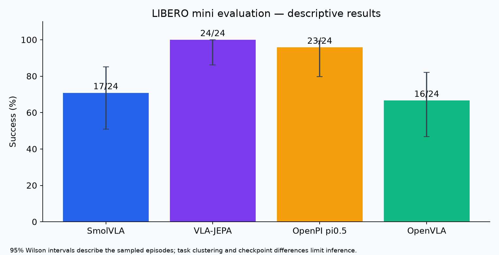
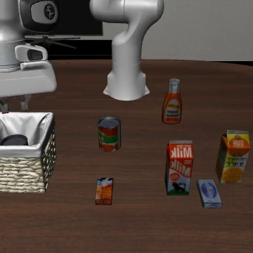
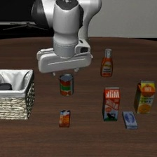
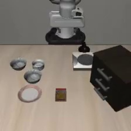
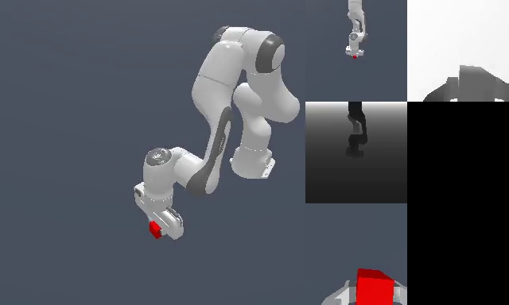

# 🔷 Embodied AI: VLA & World Models

### Reproducing, Evaluating and Comparing Five Embodied Control Projects

**Observation + Language → Action Policy · State → Latent Dynamics → Planning**

Independent reproduction and exploratory mini evaluation. Results describe specific checkpoints and selected tasks.

---

## Overview

This project covers **SmolVLA, VLA-JEPA, OpenVLA, OpenPI π0.5 and TD-MPC2**. It connects deployment, simulation evaluation, resource measurement and failure analysis. Existing valid SmolVLA results are reused; missing evaluations are attempted without overwriting earlier evidence.

## Evaluation protocol

Four VLA checkpoints are evaluated on LIBERO Spatial, Object, Goal and LIBERO-10, tasks 0 and 1, three episodes per task, seed 42: **24 episodes per model**. TD-MPC2 uses a separate ManiSkill2 mini evaluation: LiftCube, PickCube, StackCube, PickSingleYCB and TurnFaucet, three episodes each. Faucet uses fixed model 5050.

This is a small engineering study. Training data, pretrained checkpoint coverage, preprocessing, action representations and initial-state conventions can differ. Matching task names and seeds does not guarantee a controlled model comparison. TD-MPC2 scores are never ranked against LIBERO scores.

## Results

| Model | Benchmark | Completed | Success | Status |
|---|---|---:|---:|---|
| SmolVLA | LIBERO mini | 24 | 17/24 (70.8%) | Complete |
| VLA-JEPA | LIBERO mini | 24 | 24/24 (100.0%) | Complete |
| OpenPI pi0.5 | LIBERO mini | 24 | 23/24 (95.8%) | Complete |
| TD-MPC2 | ManiSkill2 mini | 12 | 9/12 (75.0%) | Incomplete / failed; see evidence |
| OpenVLA | LIBERO mini | 24 | 16/24 (66.7%) | Complete |

Historical SmolVLA runtime: **353 seconds**. Other runtime fields and errors are in the evidence, rather than substituted with estimates. Missing episodes are not counted as policy failures. Wilson intervals in figures ignore clustering across repeated tasks and should be interpreted descriptively.

## Illustrated experiment reports

- [00 inventory and reuse](reports/00_inventory_and_reuse.md)
- [01 smolvla](reports/01_smolvla.md)
- [02 vla-jepa](reports/02_vla-jepa.md)
- [03 openpi pi0 5](reports/03_openpi_pi0_5.md)
- [04 td-mpc2](reports/04_td-mpc2.md)
- [05 openvla](reports/05_openvla.md)
- [06 supplemental](reports/06_supplemental.md)
- [07 findings and limits](reports/07_findings_and_limits.md)

## Simulation rollouts

Source: `smolvla_libero\mini_benchmark_001\failure_cases\libero_10_task0_ep0.mp4`. A representative frame alone does not establish episode success.

Source: `vla_jepa_libero\mini_benchmark_003\libero_10\videos\rollout_put_both_the_alphabet_soup_and_the_tomato_sauce_in_the_basket_4da9fbe7_episode0_success.mp4`. A representative frame alone does not establish episode success.

Source: `openvla_libero\mini_benchmark_003\libero_10\rollouts\2026_10_26\2026_10_26-01_19_32--episode=1--success=False--task=put_both_the_alphabet_soup_and_the_tomato_sauce_in.mp4`. A representative frame alone does not establish episode success.

Source: `codex_session_20261026\openpi_libero_spatial\videos\task0_ep0_failure.mp4`. A representative frame alone does not establish episode success.

Source: `codex_session_20261026\tdmpc2_lift-cube\videos\lift-cube-0.mp4`. A representative frame alone does not establish episode success.

## Reproduction and evidence

- [Machine-readable summary](results/summary.csv)
- [Episode records](results/episodes.json)
- [Full run evidence and commands](results/evidence/)
- [Evaluator copies and runner](scripts/)
- [Execution notes](docs/execution.md)

Model weights and full datasets are not committed. Downloaded local archives retain videos and raw artifacts. See `results/frame_sources.json` for figure provenance. Original model repositories retain their respective licenses; this repository documents an independent reproduction.

## Upstream projects

- [SmolVLA / LeRobot](https://github.com/huggingface/lerobot)
- [OpenVLA](https://github.com/openvla/openvla)
- [OpenPI](https://github.com/Physical-Intelligence/openpi)
- [TD-MPC2](https://github.com/nicklashansen/tdmpc2)
- VLA-JEPA: consult the captured repository provenance and local evaluator configuration.
