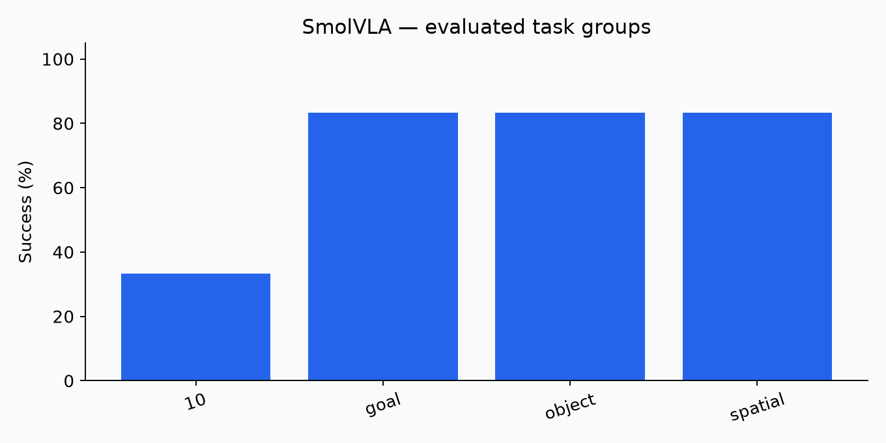

# 01. SmolVLA: evaluation report

## Question

Can the available checkpoint execute the prescribed simulation tasks, and what success and deployment cost are observed?

## Protocol and provenance

Benchmark: **LIBERO mini**. Source: `Reused 2026-10-02 baseline`. Seed: 42. VLA target: four suites ¡Á two tasks ¡Á three episodes. TD-MPC2 target: five tasks ¡Á three episodes; faucet attempted with PartNet model 5050. No model training was performed.

## Observations

Valid completed episodes: **24**. Successes: **17**. Episode evaluation errors: **0**. Completion validated: **True**.

| Suite/task | Successes | Episodes |
|---|---:|---:|
| libero_10 | 2 | 6 |
| libero_goal | 5 | 6 |
| libero_object | 5 | 6 |
| libero_spatial | 5 | 6 |

Source: `smolvla_libero\mini_benchmark_001\failure_cases\libero_10_task0_ep0.mp4`.

## Interpretation

Observed success was 70.8% on this small selected sample. It supports checkpoint-level feasibility and failure analysis, not a universal model ranking. This is a preserved historical run; runtime is not a same-session comparison. 

## Evidence and reproduction

See [raw evidence](../results/evidence/), [commands and evaluators](../scripts/), [episode records](../results/episodes.json), and [session status](../results/evidence/codex_session_20261026/status.json). Successful process exit alone is not counted as evaluation completion.

