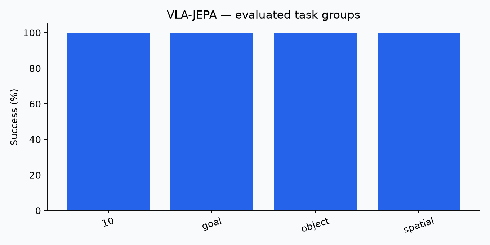

# 02. VLA-JEPA: evaluation report

## Question

Can the available checkpoint execute the prescribed simulation tasks, and what success and deployment cost are observed?

## Protocol and provenance

Benchmark: **LIBERO mini**. Source: `vla_jepa_libero\mini_benchmark_003`. Seed: 42. VLA target: four suites ¡Á two tasks ¡Á three episodes. TD-MPC2 target: five tasks ¡Á three episodes; faucet attempted with PartNet model 5050. No model training was performed.

## Observations

Valid completed episodes: **24**. Successes: **24**. Episode evaluation errors: **0**. Completion validated: **True**.

| Suite/task | Successes | Episodes |
|---|---:|---:|
| libero_10 | 6 | 6 |
| libero_goal | 6 | 6 |
| libero_object | 6 | 6 |
| libero_spatial | 6 | 6 |

Source: `vla_jepa_libero\mini_benchmark_003\libero_10\videos\rollout_put_both_the_alphabet_soup_and_the_tomato_sauce_in_the_basket_4da9fbe7_episode0_success.mp4`.

## Interpretation

Observed success was 100.0% on this small selected sample. It supports checkpoint-level feasibility and failure analysis, not a universal model ranking. 

## Evidence and reproduction

See [raw evidence](../results/evidence/), [commands and evaluators](../scripts/), [episode records](../results/episodes.json), and [session status](../results/evidence/codex_session_20261026/status.json). Successful process exit alone is not counted as evaluation completion.

