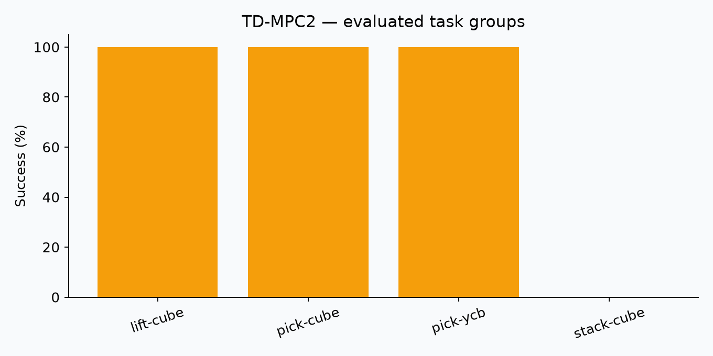

# 04. TD-MPC2: evaluation report

## Question

Can the available checkpoint execute the prescribed simulation tasks, and what success and deployment cost are observed?

## Protocol and provenance

Benchmark: **ManiSkill2 mini**. Source: `current session`. Seed: 42. VLA target: four suites ¡Á two tasks ¡Á three episodes. TD-MPC2 target: five tasks ¡Á three episodes; faucet attempted with PartNet model 5050. No model training was performed.

## Observations

Valid completed episodes: **12**. Successes: **9**. Episode evaluation errors: **0**. Completion validated: **False**.

| Suite/task | Successes | Episodes |
|---|---:|---:|
| lift-cube | 3 | 3 |
| pick-cube | 3 | 3 |
| pick-ycb | 3 | 3 |
| stack-cube | 0 | 3 |

Source: `codex_session_20261026\tdmpc2_lift-cube\videos\lift-cube-0.mp4`.

## Interpretation

Observed success was 75.0% on this small selected sample. It supports checkpoint-level feasibility and failure analysis, not a universal model ranking. ManiSkill2 state-input planning is reported separately from visual-language LIBERO policies. The attempted fixed faucet asset 5050 has a geometry/metadata mismatch: local semantics describe a rotation screen/display base, while the installed faucet metadata expects faucet switch links. Its initialization failed, so it contributes no valid episode and must not be treated as a faucet policy result. The official legacy asset endpoint timed out during a bounded connectivity check. 

## Evidence and reproduction

See [raw evidence](../results/evidence/), [commands and evaluators](../scripts/), [episode records](../results/episodes.json), and [session status](../results/evidence/codex_session_20261026/status.json). Successful process exit alone is not counted as evaluation completion.

## Recorded inference timing

391 calls; median 28.4 ms; p95 38.5 ms. Scope differs across evaluators; do not use as a universal cross-model latency ranking.
