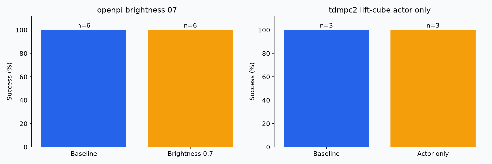

# Supplemental experiments

Brightness experiment: multiply both policy camera images by 0.7, clip to uint8; simulator dynamics and state input remain unchanged. Compare only with the matching OpenPI spatial baseline. This probes one synthetic image change, not general robustness.

TD-MPC2 actor-only experiment: set `mpc=false` on lift-cube and retain the checkpoint, evaluation seed and episode count. Compare only against the matching planning baseline. This is a planning ablation, not a new trained policy.

| Experiment | Episodes | Successes |
|---|---:|---:|
| openpi_brightness_07 | 6 | 6 |
| tdmpc2_lift-cube_actor_only | 3 | 3 |

Zero episodes means not completed; do not infer zero policy success. All extras are subject to the four-hour safety budget. Timing samples are retained in JSONL where instrumentation was available.

## openpi_brightness_07: matched descriptive comparison

Baseline: 100.0% (6 episodes). Altered condition: 100.0% (6 episodes). Difference: +0.0 percentage points. This small sample does not establish statistical significance; conclusions apply only to these selected tasks and settings.

## tdmpc2_lift-cube_actor_only: matched descriptive comparison

Baseline: 100.0% (3 episodes). Altered condition: 100.0% (3 episodes). Difference: +0.0 percentage points. This small sample does not establish statistical significance; conclusions apply only to these selected tasks and settings.

