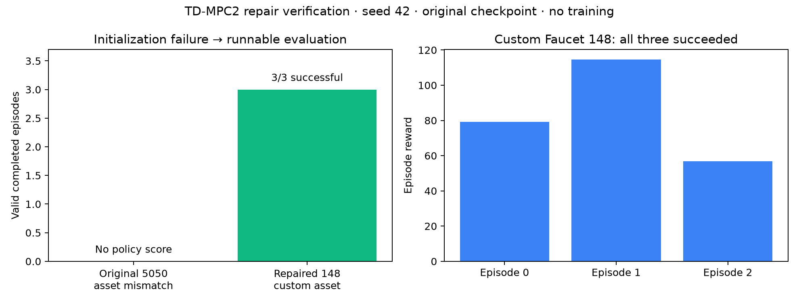
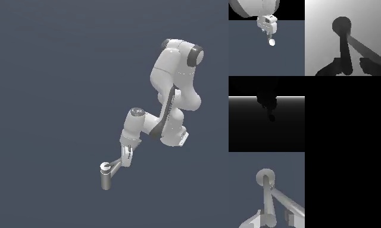
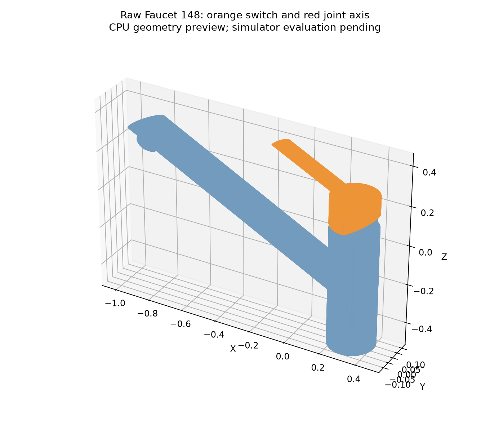

# 08. Faucet repair: initialization failure to 3/3 task success

The missing TD-MPC2 faucet evaluation now runs successfully on a **custom fixed Faucet 148**. All three episodes succeeded using the original turn-faucet-1.pt checkpoint, without training. This is an explicitly separate repair extension, not a reproduction of the unavailable legacy 5050 asset distribution.

## What changed

| Item | Original attempt | Repair evaluation |
|---|---|---|
| Asset | Raw 5050, actually Display | Raw 148, verified Faucet |
| Switch | Metadata expected missing links | link_0 / revolute joint_0 |
| Collision geometry | Incompatible asset | 21 validated convex parts |
| Initialization | Failed before any episode | Passed; state 40, action 7 |
| Completed episodes | 0 | 3 |
| Policy success | Undefined | 3/3 (100%) |

Original failure logs are preserved. A missing episode was never a policy failure and is not retrospectively relabeled successful.

## Episode evidence

| Episode | Success | Reward | Policy steps | Evaluation seconds |
|---|---|---:|---:|---:|
| 0 | Yes | 79.2943 | 24 | 2.132 |
| 1 | Yes | 114.5826 | 21 | 1.419 |
| 2 | Yes | 56.8671 | 16 | 1.149 |

Measured evaluation time sums to **4.700 seconds**; excludes startup, rendering export, transfer and reporting. Three episodes at seed 42 are a small exploratory sample, not independent-seed generalization evidence.

## Reproduction and integrity

GPU: RTX 4090D 24 GB. ManiSkill2 0.4.1.post0. State observations, pd_ee_delta_pose, MPC enabled, model_size=5, seed=42, three episodes, 100 policy-step cap and action repeat 2. Original checkpoint: models/tdmpc2/turn-faucet-1.pt. Preflight resets once with seed 42 before the evaluator's episode resets; exact scripts are archived.

Raw 148.zip SHA-256: `16376336c282405b1a8eb5591f0d75e111ce8c5544875656b5518289f509fdcf`. Collision preparation: CoACD 1.0.14, threshold 0.05, resolution 2000, MCTS iterations 150, seed 0. Metadata bounds are transformed into the URDF articulation root frame before ManiSkill's 0.3 m normalization.

See [raw metrics, videos, Hydra configuration and run logs](../results/evidence/faucet_148_repair_20261027/), [isolated launcher](../scripts/run_faucet_148.py), [shell command](../scripts/run_faucet_148.sh), [evaluator](../scripts/tdmpc2_faucet_148_eval.py), and [download/shutdown controller](../scripts/faucet_148_controller.py). The original remote transfer bundle must provide asset_candidates/148 and faucet_148_metadata.json alongside the launcher. Gated raw assets and weights are not published here.

## Completion and scope

For a source-only reproduction, install `numpy`, `scipy`, `trimesh`, and `coacd==1.0.14`; the preparation scripts expect these under their sibling `vendor` directory. Place the user's licensed raw 148 asset under `asset_candidates/148`, run the preparation and CPU-check scripts, and place the resulting metadata beside the launcher. Copy `scripts/tdmpc2_faucet_148_eval.py` to the launcher's sibling `tdmpc2_eval.py` before running. The archived shell script is the exact deployed invocation; existing patched TD-MPC2/ManiSkill wrappers from the original run are prerequisites.

The original four TD-MPC2 tasks remain 9/12 successful. The custom faucet extension is separately 3/3. Across these engineering runs, 15 episodes completed and 12 succeeded, but that mixed-asset aggregate is not the original five-task benchmark score. StackCube remains 0/3, a real policy outcome, and is not relabeled successful.

Results were downloaded and SHA-256 verified before `bash /usr/bin/shutdown`. The command returned 0 and SSH subsequently refused connections. Provider billing/stop status was not directly verified. No previously valid experiment was repeated.
